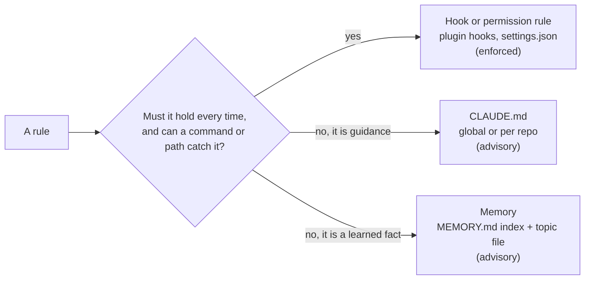

# workbench

A portable Claude Code setup in one folder: enforcement hooks, two review agents and two skills (a plugin served
from a local marketplace), plus a settings fragment, a global CLAUDE.md template, an Explore agent and a config
file that the installer puts into your Claude Code config folder. The defaults name no person and no repo; you add
yours in `workbench.json`.
Outside `private/`, the kit
names the kit's author only in LICENSE and in the owner and author fields of the two manifests
(`.claude-plugin/marketplace.json`, `plugins/workbench/.claude-plugin/plugin.json`). `private/` is git-ignored,
so nothing in it is ever published: keep your own config there (`private/<you>.workbench.json`), and any notes
that name your employer, repos or paths. When it holds a config, the tests read the names in it and fail if one
appears in a published file. The installer copies nothing from it, and no kit file names anyone else.

The config folder is `~/.claude`, or `$CLAUDE_CONFIG_DIR` when that variable is set, the same folder Claude Code
itself reads. Below, `~/.claude` means whichever of the two you use.

## What you get

| Enforced every time (hooks and permission rules) | Advisory (Claude reads it and decides) |
|---|---|
| `git stash` denied (worktrees share it) | `~/.claude/CLAUDE.md`: hard rules, how to work, models |
| `git push`, `git subtree push`, `git lfs push`, `gh pr create/new/merge`, `glab mr create/new/merge/accept` ask first | Memory: one `MEMORY.md` index per repo or repo group |
| A Claude trailer denied in commit text and in any `gh pr`/`gh issue`/`glab mr`/`glab issue` text (body, comment, review, title), including a `-F` / `--body-file` message file | Agents: `Explore` (user level), `workbench:reviewer`, `workbench:gate-runner` |
| Bare `python`, `python3.N`, `pip`, `.venv/bin/*` denied in `uv_repos` | Skill `/workbench:link-repos` (unified sessions) |
| `pytest` without an `accept` token denied in `pytest_env_required.paths`, also when wrapped (`uv run`, `python -m pytest`, `coverage run`, `env X=1`, `timeout`, `nice`, `time`) | Skill `/workbench:config-audit` (monthly check) |
| Code fed to a shell (`bash <<EOF`, `echo ... \| bash`, `eval "$X"`) is checked as one whole text, heredoc included; a script the same command writes from a heredoc or here-string and then runs (`cat > s.sh <<EOF ... EOF; bash s.sh`, `sh s.sh`, `./s.sh`, also `cat <<EOF \| tee s.sh`) is checked command by command, except a `./s.sh` whose `#!` line names a non-shell | |
| Browser launches denied above `browser_proc_max` headless browsers: `playwright`, `npx playwright`, an `e2e` or `playwright` npm script, browser MCP tools, and a runner (`node`, `nodejs`, `deno`, `bun`, `tsx`, `ts-node`, `python`, `python3`, also behind `uv run python` or `uv run X.py`, `uvx`, `npx`, `npm exec`, `pnpm exec` or `yarn tsx`, with a version on the runner word dropped: `npx tsx@4`) whose script path holds `playwright`, `e2e` or `predeploy_gate`, whose `-e`/`-c` code, heredoc or piped code names playwright or a browser `.launch(` (`chromium.launch(`, or any `.launch(` in code that names `puppeteer`, `puppeteer-core` included; not Gradio's `demo.launch()`), that runs with `--with playwright`, or whose script an earlier `sed -i`, `perl -i`, `tee` (also fed by a pipe: `cat <<EOF \| tee run.sh`, `echo ... \| tee t.js`) or `>` in the same command filled with such text | |
| `git commit` runs the repo's CI checks first (`commit_gates`) | |
| `.py` edits formatted with ruff (in `uv_repos` only) | |
| Reads of `.env`, `~/.ssh`, `~/.aws` and destructive git/docker/db commands denied | |
| Edits to `settings.json`, `workbench.json`, `CLAUDE.md`, `hooks/`, `agents/`, the installed copy `workbench-kit/` and `~/.claude.json` ask first | |

The hooks read each command segment by segment (split at `;`, `&&`, `||`, `|`, `&`, newlines and parentheses), so
a word inside a commit message or a grep pattern triggers nothing.

The settings fragment adds 17 allow, 14 ask and 14 deny rules. File rules use `Edit(...)`, which covers the Write
tool too; a `Write(path)` rule is accepted by Claude Code but never matches.

Where a rule should live:



## Install, update, uninstall

```bash
cd ~/code/workbench                             # wherever this checkout lives
bash install.sh                                 # dry run: prints the plan and a JSON diff, writes nothing
bash install.sh --apply                         # backs up, writes, installs the plugin
bash install.sh --apply --author "Your Name"    # if git config --global user.name is not set
bash install.sh --apply --replace-old           # also retire an earlier hand-made setup (see step 8)
```

Run the scripts with `bash` as shown: a checkout from a web upload or a zip has no exec bits. The installer gives
the installed copy's scripts theirs back.

`jq`, `git` and `python3` must run; the installer checks first and stops before any change if one is missing. The
dry run works without an author (it shows `<author: pass --author>`); only `--apply` needs one.

What `--apply` does:
1. Stops with the parse error if `settings.json` or `workbench.json` is not valid JSON. Nothing is written.
2. Backs up `settings.json`, `CLAUDE.md` and `agents/Explore.md`, with install.sh's own records. The first run
   writes `~/.claude/backups/workbench-original/` (`<name>.absent` marks a file that did not exist). Later runs that
   change a file write `backups/workbench-<timestamp>/`. A run that changes no file writes no backup; a missing CLI
   or a plugin that fails to load is not a file change.
3. Creates `workbench.json` from `kit.config.example.json` if it is missing, with `author` from `--author`, else
   `git config --global user.name`. It lives in the config folder, or at `$WORKBENCH_CONFIG` when that is set (the
   file the hooks read); the ask rule and CLAUDE.md name that same file.
4. Merges `user/settings.fragment.json`: lists are unioned in order, objects deep-merged, and your existing values
   win. It records the fragment it applied in `backups/workbench-created/`, so a later run adds only the entries
   that are new in the kit since then: a kit rule you deleted or moved (say, from deny to allow) stays that way, and
   the plan lists it under "removed by you, not re-added". With `CLAUDE_CONFIG_DIR` set, the fragment's
   `~/.claude/...` rules are written for that folder instead.
5. Writes `~/.claude/CLAUDE.md` from the template with that author and the real config path, only if you have none
   (else it prints a `diff` hint), and records its sha256. A CLAUDE.md the kit wrote and you never edited follows
   later template changes; once you edit it, it is yours.
6. Copies `user/agents/Explore.md` to `~/.claude/agents/Explore.md` if you have no user-level Explore (see Agents).
7. Copies the plugin's runtime files (`.claude-plugin/`, `plugins/workbench/` with its `tests/`, `LICENSE`,
   `README.md`, and `audit-task.md` rendered for your config folder) to `~/.claude/workbench-kit/`, building it
   in a temp folder and then swapping it in. The plugin runs from that copy, so moving, renaming or deleting this
   checkout changes nothing. A re-run compares the copy with the checkout (`diff -rq`) and re-syncs it when they
   differ. Before any change, the new copy must pass these checks (the dry run runs all but the last):
   - both manifests and `hooks/hooks.json` parse as JSON objects, and each marketplace `plugins[].source` is a
     folder inside the copy;
   - every `${CLAUDE_PLUGIN_ROOT}/...` path that `hooks/hooks.json` runs exists, `guard.sh`, `commit_gate.sh`,
     `browser_cap.sh`, `kitconf.sh` and `cmdparse.py` are there, `bash -n` passes on every `scripts/*.sh`, every
     `scripts/*.py` parses as Python (nothing compiled or written), and `cmdparse.py` runs on a request the way
     the hooks run it (`/usr/bin/env python3 -I`);
   - `hooks/hooks.json` wires the hooks: every key under `hooks` is a hook event Claude Code knows, the
     `PreToolUse` groups whose matcher matches `Bash` run `guard.sh`, `commit_gate.sh` and `browser_cap.sh`, the
     ones matching the Playwright, Claude Browser and Claude in Chrome MCP tools run `browser_cap.sh`, and the
     `PostToolUse` groups matching `Edit` and `Write` run `format_py.sh`. Matchers are read the way the CLI reads
     them: for these events a matcher made only of letters, digits, `_`, `|`, commas, spaces and `-` is a list of
     exact tool names split on `|` or `,` (`Edit, Write` lists two tools, and `mcp__playwright` names no MCP
     tool), and any other character makes it a regular expression (`mcp__playwright.*`);
   - the hooks that run `guard.sh`, `commit_gate.sh` and `browser_cap.sh` block: none sets `async`, `asyncRewake`
     or `once` (the CLI would not wait for its decision, or would drop the hook after one run), and the commit
     gate's `timeout` is above 170 seconds, its own budget for the checks, or absent (the CLI then waits 600 s);
   - each command string in `hooks/hooks.json` runs the way Claude Code runs it (`bash -c`, with
     `CLAUDE_PLUGIN_ROOT` set to the copy's plugin folder), so a typo in the command itself (`bahs`, a lost
     quote) is a miss that names `hooks/hooks.json`, while a script that fails on its own is named itself. Run so,
     with an empty config folder, `guard.sh` denies `git stash`, asks for `git push` and denies a commit whose
     message carries the Claude trailer, in `-m` text and in a `-F` message file. A "whole-text check" line on
     its stderr is a miss too: it means `cmdparse.py` did not run or the guard's own segment check failed, and
     the guard then reads only the command text (the `-F` file and per-command folders are not read);
   - with a temp `workbench.json` (a temp `uv_repos` folder, and a `commit_gates` entry with a check that always
     fails, for a temp repo whose origin is `example.com/smoke/repo`), `guard.sh` denies `pip install x` in that
     folder, `commit_gate.sh` denies a commit in that repo, `browser_cap.sh` denies `npx playwright test` with
     `CLAUDE_BROWSER_PROC_MAX=-1` and, while one fake browser-like process runs (a `bash` whose arguments carry
     `--remote-debugging-pipe`, killed by its PID afterwards), with `CLAUDE_BROWSER_PROC_MAX=0`, so its process
     count is used (it starts no browser), `format_py.sh` exits 0 for an edit of a `.txt` file, and `kitconf.sh`
     reads the folder and the remote back. These runs start together and take well under 2 s;
   - `claude plugin validate` on the marketplace and on the plugin, unless the CLI is missing or `--no-plugin` is
     given. An error fails the check, and so does a warning about hooks (such as "unknown hook event; entry
     ignored at runtime"), although validate itself exits 0 for it.

   If one fails, nothing is changed, the current copy keeps running, the file to fix in this checkout is named, and
   the run exits 1. These checks catch a broken, missing or unwired file and a hook that stops giving these
   decisions, not every changed rule; the hook suite (`plugins/workbench/tests/test_hooks.sh`) covers the rules. The copy a re-sync replaces moves into that run's
   backup; it is never deleted. If the new copy then fails to load (`claude plugin list` shows errors), it moves
   into that backup as `workbench-kit.failed-to-load`, the previous copy is put back (unless the plan already saw
   it fail to load), the load is checked again,
   and the run says "the new copy fails to load (...); the previous copy was put back" and exits 1. This checkout
   must live somewhere else: install.sh refuses (exit 2, nothing changed) when it is `~/.claude/workbench-kit`,
   sits inside it, or contains it.
8. Sets up the plugin with `claude plugin marketplace add ~/.claude/workbench-kit`, `claude plugin install
   workbench@workbench` (always right after a marketplace add, so one run finishes the step even when
   `settings.json` already enables a plugin that is not installed) and `claude plugin enable workbench@workbench`,
   as needed (`--no-plugin` skips these). It
   then confirms three things: `settings.json` shows the plugin enabled, `plugins/known_marketplaces.json` reads the
   marketplace from the installed copy, and `claude plugin list` does not show it as failed to load. If one fails
   it says which, prints the `/plugin ...` steps or the file to fix, and exits 1.
9. Leaves an earlier hand-made setup alone unless you pass `--replace-old`. Without it, the plan lists user-level
   hook entries for `~/.claude/hooks/{guard,browser_cap,commit_gate,format_py}.sh` (any spelling of the config
   folder: `~/`, `$HOME`, `$CLAUDE_CONFIG_DIR` or absolute) and user agents `reviewer.md` and `gate-runner.md` as
   "will run alongside the plugin". With it, and only once the plugin is confirmed (which needs the claude CLI on
   PATH), those hook entries are removed and those agents are moved into the backup. The scripts in
   `~/.claude/hooks/` stay on disk.

Once the plugin is confirmed, running it again changes nothing. `--home DIR` uses `DIR/.claude` and ignores
`CLAUDE_CONFIG_DIR` and `WORKBENCH_CONFIG` (the tests use it).

**Update:** pull or edit this checkout, then run `bash install.sh --apply` again: it re-syncs the installed copy
(and any new fragment entry, Explore or CLAUDE.md template change), then `/reload-plugins` in a session. Editing
the checkout alone changes nothing that runs. The copy it replaced is kept in that run's backup, and
`bash uninstall.sh --latest` puts it back with the plugin still installed. A new copy that fails its checks never
replaces the running one, and one that fails to load is swapped back out by the same run (step 7).

**Uninstall:** `bash uninstall.sh` prints its plan and asks before any change; anything but `y` changes nothing. With
no terminal (for example from Claude's Bash tool) it changes nothing unless you pass `--yes`. `--dry-run` prints the
plan only. On yes it uninstalls the plugin, moves `~/.claude/workbench-kit/` into the backup folder, and restores
`settings.json`, `CLAUDE.md` and `agents/Explore.md` from `backups/workbench-original/`, the state before the
install, plus the agents `--replace-old` retired. The current files are saved in that backup folder first, and the
plan says for each file whether it changed since install. After the restore, the folder is renamed
`workbench-original.restored-<timestamp>` (with that install's timestamped backups inside), so a later install takes
a fresh snapshot and your changes made in between survive the next uninstall. When `settings.json` would be
overwritten or moved aside, the plan lists the keys and rules that changed since the backup and are not kit or
plugin entries, since those edits then live only in the saved copy.

The default and `--latest` restores remove `CLAUDE.md` and `Explore.md` only if the installer wrote them and you
have not changed them since; otherwise they stay and uninstall says so. A file that already matches the backup copy
is left as it is.

`--latest` restores the newest timestamped backup instead (the state before the last `--apply`), records and
installed copy included: if that run re-synced the copy, the previous copy comes back to `~/.claude/workbench-kit`,
and if the plugin was installed before that run (the backup's `settings.json` lists it; the plan shows its
`enabled` value there), the plugin and its marketplace stay installed. The run then reports what
`claude plugin list` shows: enabled and loading; installed but disabled (as it was before that run, if the backup
had it disabled), with the `claude plugin enable` command that turns the hooks on; not installed, with
`install.sh --apply` to set it up; or failing to load. Otherwise the plugin is removed as in the default, and a copy
that run created is moved into the backup folder.

`--keep-files` removes the plugin but keeps your files, writes back the hook entries `--replace-old` removed (from
the original backup) and the agents it retired, and archives the backups the way the default does, so the next
install takes a fresh snapshot of your files as they are then. `settings.json`, `CLAUDE.md` and `Explore.md` stay
even when the installer wrote them, so the kept `CLAUDE.md` still says the workbench hooks back its rules while no
workbench hook runs: edit that line, or run the default uninstall instead. Uninstall never deletes `workbench.json`,
memory or audits.

## Configure `~/.claude/workbench.json`

A missing file or key turns that rule off. Paths may start with `~/`. Everything under `_examples` is ignored by the
scripts: it shows one entry of each shape to copy from.

| Key | Drives |
|---|---|
| `author` | Your name in the CLAUDE.md template and in the guard's messages (who authors commits, whose go-ahead a push needs) |
| `uv_repos` | Repos (and their worktrees) where bare `python`/`pip`/`.venv/bin` is denied and where `.py` edits get ruff |
| `pytest_env_required.paths` | Folders where `pytest` must name its test database |
| `pytest_env_required.accept` | Tokens that count as naming it, for example `--env-file` or `TEST_DATABASE_URL=` |
| `browser_proc_max` | Headless browser cap; default 25 |
| `commit_gates[].remote` | `owner/repo`, compared exactly with the `origin` URL after the scheme, host and `.git` are removed |
| `commit_gates[].require` | A path under the repo root; when it is missing the whole gate is skipped (for example `node_modules/.bin/tsc` before `npm install`) |
| `commit_gates[].on_missing_tool` | `skip` (default) or `deny`: what a check does when its tool is missing (exit 127, `command not found`, `Failed to spawn`). A skip is reported to Claude |
| `commit_gates[].checks[].name` | The label in the deny message |
| `commit_gates[].checks[].files` | POSIX ERE matched against each changed path; no match skips the check |
| `commit_gates[].checks[].cmd` | Run with `bash -c` in the repo root; `{files}` becomes the matching paths (passed in chunks for large change sets). Non-zero denies the commit with the first 25 lines |
| `repo_groups[].name` | The group name for `/workbench:link-repos NAME` |
| `repo_groups[].repos` | The primary checkouts to link |
| `repo_groups[].memory_dir` | The group's shared auto-memory folder (`autoMemoryDirectory`) |

| Environment variable | Effect |
|---|---|
| `CLAUDE_CONFIG_DIR` | The Claude Code config folder. The installer, the hooks and link-repos use it in place of `~/.claude`, and link-repos then writes import approvals to `$CLAUDE_CONFIG_DIR/.claude.json` instead of `~/.claude.json` |
| `WORKBENCH_CONFIG` | Read this file instead of `workbench.json` in the config folder; the installer writes and protects this file too |
| `WORKBENCH_GATE_TIMEOUT` | Seconds all of one commit's checks may take together; default 170, under the hook's 180. When it runs out the commit is allowed with a note |
| `CLAUDE_BROWSER_PROC_MAX` | Overrides `browser_proc_max` |

## Agents and namespacing

Plugin agents are namespaced: the plugin ships two, `workbench:reviewer` and `workbench:gate-runner`. A user-level
(`~/.claude/agents/`) or project-level agent with the same name wins over a plugin agent, and both show in the agent
list; `--replace-old` retires your user-level `reviewer.md` and `gate-runner.md` so only the plugin's remain. The
built-in Explore is replaced only by a user- or project-level agent named `Explore`, never by a plugin's, so the
kit keeps its Explore (Sonnet, read-only) in `user/agents/`, outside the plugin, and the installer copies it to
`~/.claude/agents/Explore.md` when you have none. Your own Explore always stays.

## Link repos into one session

In a session, run `/workbench:link-repos NAME` (a group from `workbench.json`) or
`/workbench:link-repos --group NAME --memory-dir ~/.claude/NAME-memory REPO REPO`. The skill runs its script by path
(`link_repos.py` in the skill folder), so the uv rule never blocks it. It shows a dry-run plan first and writes only
after you say yes. Per repo it sets the shared `autoMemoryDirectory`, lists the siblings under
`permissions.additionalDirectories`, writes a git-excluded `.claude/rules/linked-repos.md` that imports each
sibling's `CLAUDE.md`, and keeps `.worktreeinclude` in step.

With your yes it also approves the external imports in `~/.claude.json`. That approval is one flag per project and
covers every external import in it, so the script first scans the repo for other `@` imports that point outside it:
`CLAUDE.md`, `.claude/CLAUDE.md`, `CLAUDE.local.md`, `AGENTS.md`, everything under `.claude/rules/` (all subfolders),
committed copies of these files in subfolders, and the in-repo files they import, up to 5 hops. Each one found is an
`[external]` line in the plan. A file over the 1 MiB scan cap, or one that is not a regular file, is not read; it is
listed as `[unscanned]`. The approval step stops with exit code 3 while any `[external]` target is not named with
`--allow-external PATH`, and while any `[unscanned]` file exists (fix that file first; it cannot be allowed).

## Daily workflow

- **Start in one repo of a group** (for example `api`, in a group of `api` and `web`). Siblings are readable and
  their CLAUDE.md arrives through the bridge rule; memory is shared across the group.
- **Worktrees** for parallel work, three writing sessions at most. Commit to a WIP branch; never stash.
  `.worktreeinclude` copies `CLAUDE.local.md` and the bridge rule into each new worktree.
- **Commit gate**: a failing check denies the commit and shows the first 25 lines. Fix and commit again.
  In a worktree without `.venv`, uv checks use the primary checkout's `.venv`.
- **Push, PR, MR** always ask. Approve only when you meant it in this session.
- **Browser work** one agent at a time, never inside parallel subagents or workflows.
  Playwright with `--workers=1`; `pkill -f chrome-headless-shell` afterwards.
- **Models and effort**: Opus at medium for the main session, Sonnet subagents for exploring and gate runs.
  Raise effort for migrations, auth, money paths and audits.
- **Memory hygiene**: one line per entry in `MEMORY.md`, detail in topic files. Claude Code loads only the
  first 200 lines or 25 KB of the index. Turn a rule Claude keeps missing into a hook.
- **Monthly audit**: add a scheduled task (monthly, for example the 1st at 09:00) and paste the text of
  `~/.claude/workbench-kit/audit-task.md` as its prompt: the installer renders `user/audit-task.md` there with your
  config paths. It is the prompt body only: no frontmatter, nothing to strip. It runs `/workbench:config-audit`,
  writes `~/.claude/audits/<YYYY-MM>.md` and changes nothing. If the plugin is missing, disabled or fails to load,
  it runs a short inline check instead and reports that first.

## Tests

```bash
bash tests/test_install.sh                       # install.sh and uninstall.sh (sandbox HOME, fake claude CLI)
bash plugins/workbench/tests/test_hooks.sh       # guard, browser cap, commit gate, formatter (sandbox HOME, temp repos)
bash plugins/workbench/tests/test_link_repos.sh  # link_repos.py (sandbox HOME, temp repos)
claude plugin validate .                         # the marketplace; also run it on plugins/workbench
```

`test_install.sh` covers the dry run, first and second apply, uninstall (no terminal, `--dry-run`, n and y on a
terminal, `--yes`, `--latest`, `--keep-files`), invalid JSON, existing files, the author order, the plugin step with
a fake CLI (success, failure, missing CLI, enabled in the app, disabled, install that does nothing, fails to load),
the installed copy (moved and deleted checkout, re-sync after an edit, a checkout at the copy's path, validation
before a re-sync), the three-way merge, `--replace-old` with your own hooks and agents, two runs then uninstall,
`--latest` after a kit update, `--keep-files` then a reinstall, your own Explore, the kit's Explore, the preflight,
install and uninstall cycles with your edits in between, `CLAUDE_CONFIG_DIR`, `WORKBENCH_CONFIG`, a plugin that
`settings.json` enables but nothing installed, repeated runs without the CLI or with a plugin that fails to load,
the copy checks (a guard that decides nothing, a hook script that is missing, shell and Python syntax errors, a
marketplace source outside the copy, a `cmdparse.py` that is missing or does not run, a guard that falls back to
its whole-text check, a cap whose process count is always 0, matchers read as the CLI reads them, a typo in a
`hooks.json` command, a deciding hook that is `async` or `once`, a commit-gate timeout at or under 170 s), putting
the previous copy back when the new one fails to load, the plugin state `--latest` reports, and an installed copy
that names nobody from `private/`.

Each suite works in its own `mktemp -d /tmp/workbench-test-*` folder and removes only that folder, so two runs never
touch each other's files. None of them reads or writes the live `~/.claude`. The installed copy also holds
`plugins/workbench/tests/`, so the monthly audit runs the hook self-test from it; `tests/test_install.sh` is only in
the checkout. In a checkout with no exec bits (a web upload or a zip), `test_hooks.sh` and
`test_link_repos.sh` fail their exec-bit checks; run them from the installed copy, which has them.

## Migrate an existing hand-made setup

For a machine that already has hooks in `~/.claude/hooks/`, agents in `~/.claude/agents/` and its own CLAUDE.md:

1. Write `~/.claude/workbench.json` before the first install; the installer never overwrites it. Start from
   `kit.config.example.json` and add your repos, gates and groups. Keep your own copy in the git-ignored `private/`
   folder and copy it on each machine (`cp -n private/*.workbench.json ~/.claude/workbench.json`; `-n` leaves an
   existing file alone). Nothing in `private/` is published, and a teammate's install never reads it.
2. Run `bash install.sh --replace-old` and read the plan: your CLAUDE.md, your Explore agent and every settings value
   you already have stay; the old hook entries and your `reviewer.md` and `gate-runner.md` are listed for retiring.
3. Run `bash install.sh --apply --replace-old` with the claude CLI on PATH. The old entries and agents go only once the
   plugin is confirmed (step 8 above); without the CLI they stay and it prints the in-app steps.
4. In a new session, `/hooks` should list each of guard, commit gate, browser cap and format once, from the plugin.
5. For repos you linked by hand, run `/workbench:link-repos NAME`; the dry run should plan few or no changes.
6. Replace the prompt of an existing monthly audit task with the text of `~/.claude/workbench-kit/audit-task.md`.

`bash uninstall.sh` puts the old hook entries and agents back with everything else; `bash uninstall.sh --keep-files`
puts back only those and removes the plugin.

## Troubleshooting

| Symptom | Check |
|---|---|
| A rule stopped working | `claude doctor` (invalid settings files are skipped whole) |
| `install.sh` exits 2 naming `workbench-kit` | The checkout is the installed copy's folder, inside it or around it; move it elsewhere and run it from there |
| `install.sh --apply` says the kit does not validate | Fix the file it names in this checkout and run it again; until then the installed copy keeps running unchanged |
| `install.sh --apply` says the new copy fails to load | The previous copy is back and running; fix the file `claude plugin list` names in this checkout, then run it again |
| A hook did not fire or fires twice | `/hooks` in a session; `claude plugin details workbench`; old hand-made entries run alongside until `--replace-old` |
| `claude plugin list` shows workbench "failed to load" | Fix the file it names in this checkout (install.sh prints the path), then `bash install.sh --apply` to re-sync the copy |
| Context feels heavy | `/context` |
| Something is broken and you cannot tell what | `claude --safe-mode` (all customizations off), then compare |
| Plugin missing or disabled | `claude plugin list`; re-run `bash install.sh --apply` |
| link-repos stops with exit 3 | An `[external]` import needs `--allow-external PATH`, or an `[unscanned]` file must be fixed |

## Known limits

- **Guardrails, not walls.** The hooks parse each command, but they still read command text: a script file or an
  alias can slip past. A command the parser cannot split (unbalanced quotes), or code it cannot see into (a shell
  reading stdin, `eval` or `bash -c` of a variable), falls back to keyword matching over that part of the text. The
  sandbox is the real wall.
- **Message files.** The trailer check reads a message file named literally or
  through `~`, `$HOME`, `$TMPDIR`, `$PWD` (or `$(pwd)`); a file named through any other variable is not read. A
  trailer that a `sed`, `awk` or `perl` segment of the same command writes into the file first
  (`sed -i '$a ...' f && git commit -F f`) is not seen, since the file is read before the command runs, and a
  `git commit -t` template is not read at all.
- **Piped message text.** Only a bare `cat` in a `$(...)` (`--body "$(cat)"`) reads the text piped into a `gh`,
  `glab` or `git commit` command; `$(< /dev/stdin)`, `$(sed ...)`, `$(tr ...)`, `$(head -c N)` there and
  `... | xargs gh ...` are not checked for the trailer.
- **Wrappers.** `uv run git`, `sudo` and `find -exec` are not parsed, so a git command behind them is not checked.
- **Nested commands are parsed.** What `git submodule foreach`, `git rebase --exec` (`-x`) and `git bisect run`
  run, and what `uvx` and `uv tool run` start (a version such as `pytest@8` is dropped first), is checked as its
  own segment in that segment's folder. A `pytest` there needs its accept token like any other; a token set in front
  of the wrapper (`TOKEN=... git bisect run pytest`) counts. `uvx git` and `uv tool run git` start a PyPI tool, not
  git, and are not checked as git.
- **A nested command held in a variable is not read.** `git submodule foreach "$CMD"`, `git rebase --exec "$CMD"`
  and `git bisect run "$CMD"` are neither parsed nor checked as text, unlike `bash -c "$CMD"`.
- **The browser cap counts what the command shows.** `make e2e`, `pytest tests/e2e` and `docker run` are not
  counted: what a Makefile, a pytest plugin or a container starts is not read. Nor is a runner whose script name
  and code in the command never name a browser (`node scripts/run.js` that imports Playwright).
- **A runner inside a message is message text.** A `node` or `python` in the `$(...)` of a `git commit`, `gh` or
  `glab` command is not counted by the cap, even when its own heredoc launches a browser.
- **More runner forms the cap misses.** `npx --package=playwright ...`, a file piped or redirected into a runner
  (`cat e2e/x.mjs | node`, `node < e2e/x.mjs`), code held in a variable and piped into `node`, and a script written
  by `echo` or `printf` with `>` and then run (`./run.sh`, `bash run.sh`) are not counted.
- **Launch text in a note counts.** Browser-launch text (`chromium.launch(`, or `puppeteer` with `.launch(`) in an
  earlier heredoc of the same command counts for a later `node` or `python` run even when that heredoc is a note or
  a message (`git commit -F`, `git tag -F -`, `gh --body-file -`): a false deny once the cap is reached.
- **A written script run from nested code is not read.** The heredoc body of a script the command writes is
  checked when a top-level `bash s.sh`, `sh s.sh` or `./s.sh` runs it, not when the run sits inside `$(...)`,
  `bash -c '...'` or `source`.
- **The install smoke check can be fooled by a busy machine.** It edits nothing, but its browser-cap test counts
  processes. A broken pgrep pattern in `browser_cap.sh` can pass it while another process (a concurrent hook's own
  `pgrep`) holds the pattern text in its arguments. Re-run `bash install.sh` when no Claude session is busy if you edited
  that line.
- **Smoke messages name the parser first.** When guard.sh's own call to cmdparse.py breaks, install refuses but
  names `scripts/cmdparse.py`; check the call in `guard.sh` too.
- **Matcher regexes follow Python, not the app.** The wiring check reads a hook matcher with Python's `re`;
  an inline flag such as `(?i)Bash` passes it, while Claude Code's JavaScript regex matches nothing.
- **Per-command folders.** The pytest and uv rules use each command's own folder (after `cd X &&`, `git -C X`,
  `uv run --directory X` or `--project X`), not the session's folder.
- **The plugin runs from the installed copy.** After editing or pulling this checkout,
  run `bash install.sh --apply` again; until then the old copy keeps running. Keep the checkout out of
  `~/.claude/workbench-kit`: install.sh refuses a checkout there, inside it or around it.
- **Old setups run alongside.** Hand-made hook entries and user `reviewer.md`/`gate-runner.md` stay until you pass
  `--replace-old`, which needs the claude CLI on PATH to confirm the plugin loads.
- **Uninstall asks first.** It changes nothing without `y` on a terminal or `--yes`; `--dry-run` shows the plan,
  `--latest` restores the newest backup, `--keep-files` removes only the plugin.
- **Settings-added directories load no instructions.** `permissions.additionalDirectories` gives file access
  only. Sibling instructions arrive through the git-excluded bridge rule's `@` imports.
- **External imports need approval per project.** Until a repo is approved (the link-repos `--approve-imports`
  step, or the dialog Claude Code shows once), the bridge rule's imports stay off. The approval covers every external
  import in that project, which is why link-repos lists them first and refuses (exit 3) until you name each one.
- **Plugin agents are namespaced.** See Agents; only the copied user-level Explore replaces the built-in one.
- **Hooks fail open.** Without `jq` every hook steps aside; without `workbench.json` or one of its keys, that rule
  is off. The permission rules in `settings.json` still apply, and the monthly audit is what notices.
